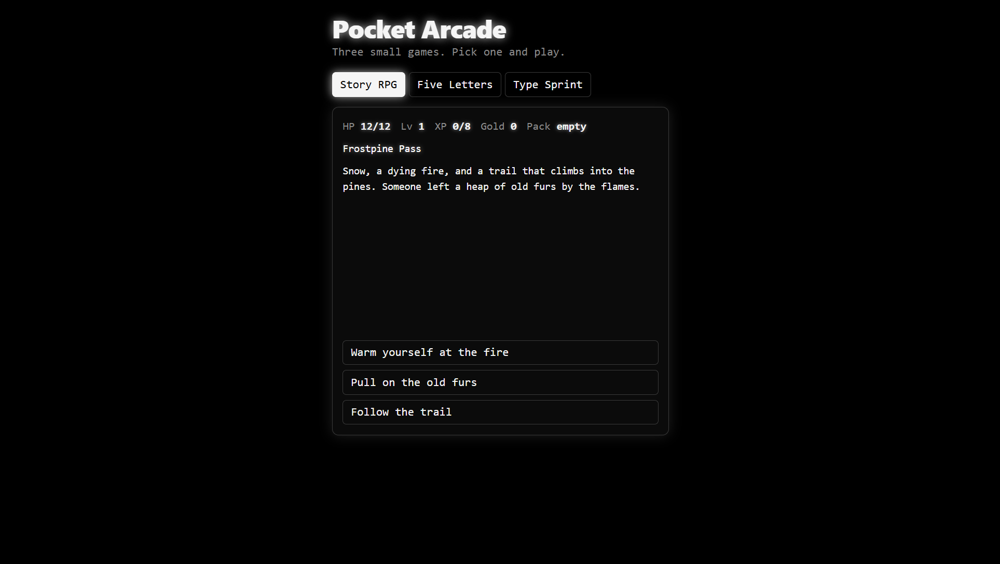
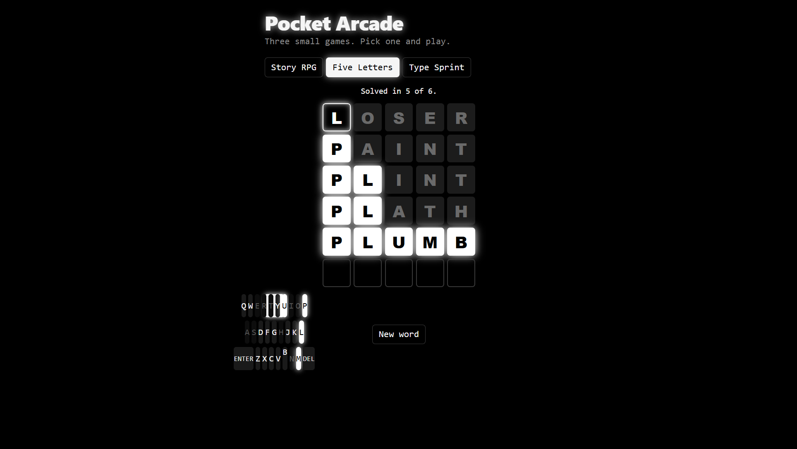
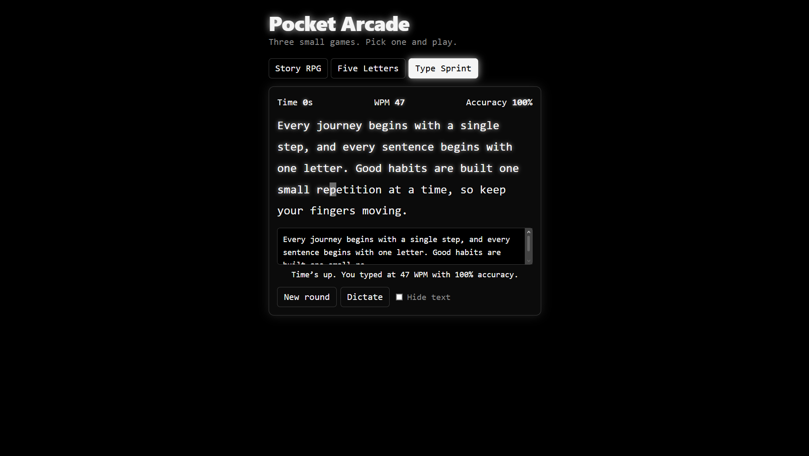

# 🎮 Pocket Arcade

A free browser-based gaming hub featuring three mini-games in one place.

Explore a story-driven RPG, challenge yourself with a five-letter word puzzle, or test your typing speed.

**No downloads. No sign-ups. Just play!**

🌐 **Live Demo:** [Pocket Arcade](https://cyberswiftgit.github.io/ProjectPocketArcade/)

---

## 📸 Screenshots

### Story RPG


### Five Letters


### Type Sprint


---

## 🕹️ Games

- **Story RPG:** Explore adventures, fight enemies, collect items and level up.
- **Five Letters:** Guess the hidden five-letter word in six attempts.
- **Type Sprint:** Test your typing speed and accuracy in a 30-second challenge.

---

## 🛠️ Built With

- HTML5
- CSS3
- JavaScript
- Web Speech API

---

## 🚀 Run Locally

1. Clone the repository:

   ```bash
   git clone https://github.com/cyberswiftgit/ProjectPocketArcade.git